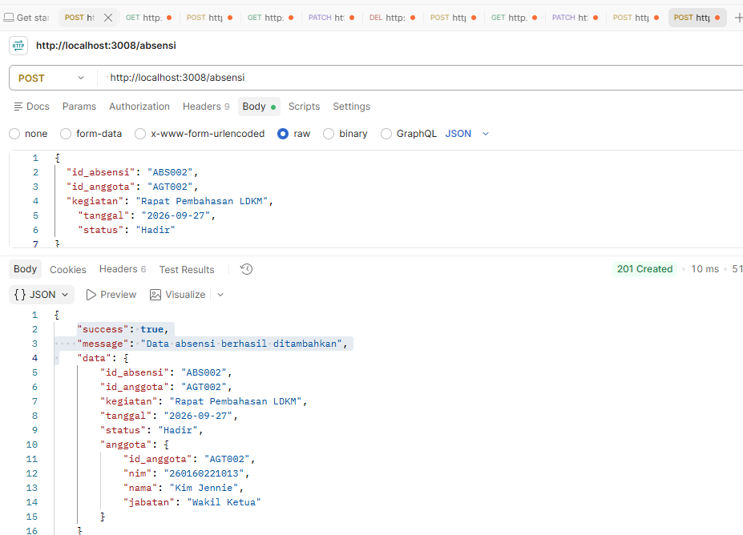
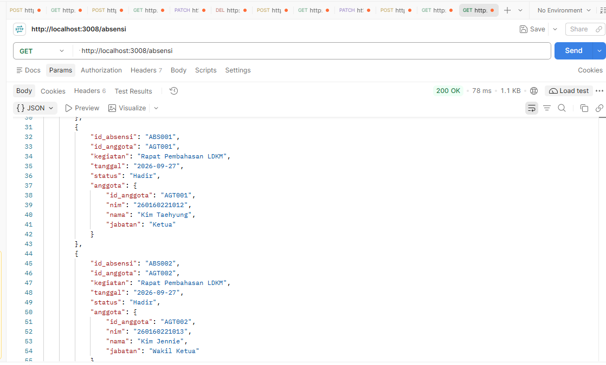
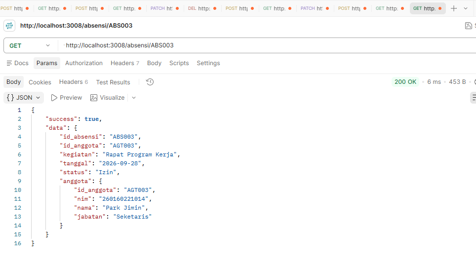
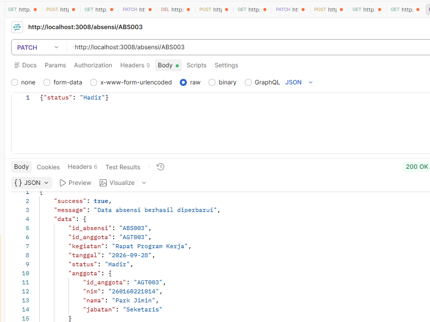
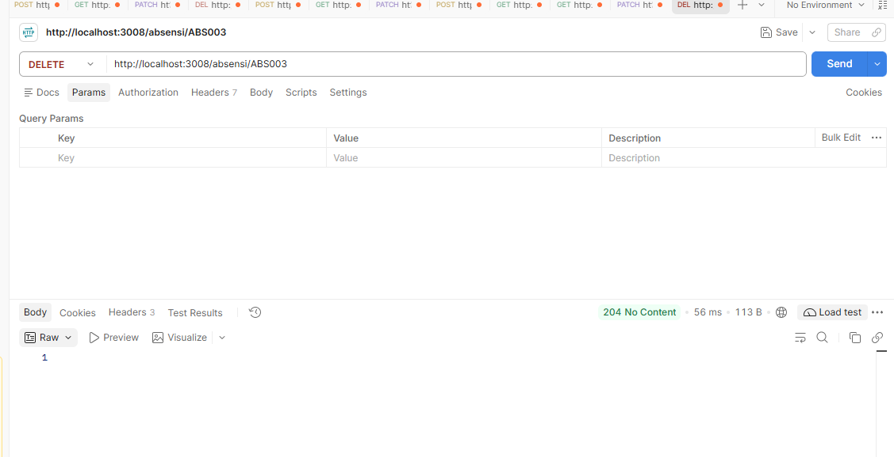

# UTS – REST API Sistem Informasi Absensi Organisasi

**Nama:** Nadya Zahra Aulia  
**NPM:** 240160221030  
**Mata Kuliah:** Pemrograman Backend

## 1. Deskripsi Proyek

Sistem Informasi Absensi Organisasi merupakan REST API yang dikembangkan untuk mengelola data anggota dan pencatatan kehadiran dalam kegiatan organisasi.

Aplikasi ini dibangun menggunakan Node.js, Express.js, dan TypeScript, dengan Prisma ORM sebagai penghubung ke database SQLite.

Sistem memiliki dua resource utama, yaitu Anggota dan Absensi. Data absensi terhubung dengan data anggota melalui relasi one-to-many, sehingga satu anggota dapat memiliki beberapa catatan kehadiran dalam kegiatan organisasi.

## 2. Teknologi yang Digunakan

- **Node.js** – Menjalankan aplikasi pada sisi server.
- **TypeScript** – Mengembangkan aplikasi dengan sistem tipe data.
- **Express.js 5** – Membuat REST API dan mengatur routing.
- **Prisma ORM 7** – Mengelola operasi database.
- **SQLite** – Menyimpan data anggota dan absensi.
- **Postman** – Menguji endpoint REST API.
- **cURL** – Mengirim request HTTP melalui terminal.

## 3. Struktur Folder

```text
240160221030-Nadya-Zahra/
├── generated/
│   └── prisma/
├── prisma/
│   ├── migrations/
│   └── schema.prisma
├── src/
│   ├── controller/
│   │   ├── anggota.controller.ts
│   │   └── absensi.controller.ts
│   ├── routes/
│   │   ├── anggota.routes.ts
│   │   └── absensi.routes.ts
│   └── service/
│       ├── anggota.service.ts
│       └── absensi.service.ts
├── ss
├── .env
├── .env.example
├── app.ts
├── client.ts
├── package-lock.json
├── package.json
├── prisma.config.ts
└── README.md
├── server.ts
└── tsconfig.json
```

## 4. Cara Menjalankan Proyek

Pastikan Node.js dan npm sudah terpasang pada komputer.

### A. Instalasi Dependensi

Buka terminal pada folder proyek, kemudian jalankan:

```bash
npm.cmd install
```

### B. Konfigurasi Environment

Buat file `.env` pada direktori utama proyek:

```env
DATABASE_URL="file:./prisma/dev.db"
PORT=3008
```

### C. Generate Prisma Client

```bash
npx prisma generate
```

### D. Migrasi Database

```bash
npx prisma migrate dev
```

Migrasi digunakan untuk membuat tabel database berdasarkan struktur model pada `schema.prisma`.

### E. Menjalankan Server

```bash
npm.cmd run dev
```

Server berjalan pada alamat:

```text
http://localhost:3008
```

### F. Mengakses API

Alamat utama API:

```text
http://localhost:3008/
```

Pemeriksaan koneksi API dan database:

```text
http://localhost:3008/api/health
```

## 5. Struktur dan Alur Kerja Sistem

Sistem menggunakan pola pemisahan Route, Controller, dan Service agar setiap bagian memiliki tanggung jawab masing-masing.

1. **Routes** bertugas menerima request dan mengarahkan endpoint ke controller.
2. **Controller** bertugas melakukan validasi input dan mengatur respons HTTP.
3. **Service** bertugas menjalankan logika bisnis dan operasi database.
4. **Prisma ORM** menjadi penghubung antara aplikasi dengan database.
5. **SQLite** digunakan untuk menyimpan data anggota dan absensi.

Alur kerja sistem:

```text
Pengguna / Postman / cURL
          |
          v
        Routes
          |
          v
      Controller
          |
          v
        Service
          |
          v
      Prisma ORM
          |
          v
     Database SQLite
```

## 6. Struktur Data dan Relasi

Sistem memiliki dua model utama.

### A. Model Anggota

Model Anggota digunakan untuk menyimpan informasi anggota organisasi.

| Field | Keterangan |
|---|---|
| id_anggota | Identitas unik anggota |
| nim | Nomor Induk Mahasiswa dan bersifat unik |
| nama | Nama anggota |
| jabatan | Jabatan anggota dalam organisasi |

### B. Model Absensi

Model Absensi digunakan untuk menyimpan informasi kehadiran anggota dalam kegiatan organisasi.

| Field | Keterangan |
|---|---|
| id_absensi | Identitas unik data absensi |
| id_anggota | Identitas anggota yang melakukan absensi |
| kegiatan | Nama kegiatan organisasi |
| tanggal | Tanggal pelaksanaan kegiatan |
| status | Status kehadiran anggota |

Status kehadiran yang digunakan meliputi:

- Hadir
- Izin
- Sakit

### C. Relasi Antar Model

Model Anggota dan Absensi memiliki relasi one-to-many. Artinya, satu anggota dapat memiliki lebih dari satu data absensi, sedangkan setiap data absensi terhubung dengan satu anggota.

Pada respons API Absensi, informasi anggota juga ditampilkan melalui relasi, meliputi ID anggota, NIM, nama, dan jabatan.

## 7. Daftar Endpoint API

### A. Endpoint Anggota

| Method | Endpoint | Fungsi |
|---|---|---|
| GET | `/anggota` | Menampilkan seluruh anggota |
| GET | `/anggota/:id` | Menampilkan anggota berdasarkan ID |
| POST | `/anggota` | Menambahkan anggota |
| PATCH | `/anggota/:id` | Memperbarui data anggota |
| DELETE | `/anggota/:id` | Menghapus anggota |

### B. Endpoint Absensi

| Method | Endpoint | Fungsi |
|---|---|---|
| GET | `/absensi` | Menampilkan seluruh data absensi |
| GET | `/absensi/:id` | Menampilkan detail absensi |
| POST | `/absensi` | Menambahkan data absensi |
| PATCH | `/absensi/:id` | Memperbarui data absensi |
| DELETE | `/absensi/:id` | Menghapus data absensi |

### C. Endpoint Umum

| Method | Endpoint | Fungsi |
|---|---|---|
| GET | `/` | Menampilkan informasi API |
| GET | `/api/health` | Memeriksa koneksi API dan database |

## 8. Contoh Pengujian API Menggunakan cURL

Pengujian API dilakukan menggunakan cURL melalui terminal PowerShell. Seluruh request menggunakan alamat dasar `http://localhost:3008`.

### A. Pengujian Endpoint Anggota

**1. GET – Menampilkan Semua Anggota**

```powershell
curl.exe -i http://localhost:3008/anggota
```

Respons yang diharapkan: `200 OK`.

**2. POST – Menambahkan Anggota**

```powershell
curl.exe -i -X POST http://localhost:3008/anggota `
-H "Content-Type: application/json" `
-d '{"id_anggota":"AGT004","nama":"Contoh Anggota","nim":"240160221015","jabatan":"Anggota"}'
```

Respons yang diharapkan: `201 Created`.

**3. GET – Detail Anggota**

```powershell
curl.exe -i http://localhost:3008/anggota/AGT001
```

Respons yang diharapkan: `200 OK`.

**4. PATCH – Memperbarui Anggota**

```powershell
curl.exe -i -X PATCH http://localhost:3008/anggota/AGT001 `
-H "Content-Type: application/json" `
-d '{"jabatan":"Wakil Ketua"}'
```

Respons yang diharapkan: `200 OK`.

**5. DELETE – Menghapus Anggota**

```powershell
curl.exe -i -X DELETE http://localhost:3008/anggota/AGT004
```

Respons yang diharapkan: `204 No Content`, apabila anggota tidak memiliki data absensi yang masih terhubung.

### B. Pengujian Endpoint Absensi

**1. GET – Menampilkan Semua Data Absensi**

```powershell
curl.exe -i http://localhost:3008/absensi
```

Respons yang diharapkan: `200 OK`.

**2. POST – Menambahkan Data Absensi**

```powershell
curl.exe -i -X POST http://localhost:3008/absensi `
-H "Content-Type: application/json" `
-d '{"id_absensi":"ABS002","id_anggota":"AGT002","kegiatan":"Rapat Pembahasan LDKM","tanggal":"2026-09-27","status":"Hadir"}'
```

Respons yang diharapkan: `201 Created`.

Contoh response berdasarkan hasil pengujian Postman:

```json
{
  "success": true,
  "message": "Data absensi berhasil ditambahkan",
  "data": {
    "id_absensi": "ABS002",
    "id_anggota": "AGT002",
    "kegiatan": "Rapat Pembahasan LDKM",
    "tanggal": "2026-09-27",
    "status": "Hadir",
    "anggota": {
      "id_anggota": "AGT002",
      "nim": "260160221013",
      "nama": "Kim Jennie",
      "jabatan": "Wakil Ketua"
    }
  }
}
```

**3. GET – Detail Absensi**

```powershell
curl.exe -i http://localhost:3008/absensi/ABS003
```

Respons yang diharapkan: `200 OK`.

Contoh response berdasarkan hasil pengujian Postman:

```json
{
  "success": true,
  "data": {
    "id_absensi": "ABS003",
    "id_anggota": "AGT003",
    "kegiatan": "Rapat Program Kerja",
    "tanggal": "2026-09-28",
    "status": "Izin",
    "anggota": {
      "id_anggota": "AGT003",
      "nim": "260160221014",
      "nama": "Park Jimin",
      "jabatan": "Sekretaris"
    }
  }
}
```

**4. PATCH – Memperbarui Data Absensi**

```powershell
curl.exe -i -X PATCH http://localhost:3008/absensi/ABS003 `
-H "Content-Type: application/json" `
-d '{"status":"Hadir"}'
```

Respons yang diharapkan: `200 OK`.

Contoh response berdasarkan hasil pengujian Postman:

```json
{
  "success": true,
  "message": "Data absensi berhasil diperbarui",
  "data": {
    "id_absensi": "ABS003",
    "id_anggota": "AGT003",
    "kegiatan": "Rapat Program Kerja",
    "tanggal": "2026-09-28",
    "status": "Hadir",
    "anggota": {
      "id_anggota": "AGT003",
      "nim": "260160221014",
      "nama": "Park Jimin",
      "jabatan": "Sekretaris"
    }
  }
}
```

**5. DELETE – Menghapus Data Absensi**

```powershell
curl.exe -i -X DELETE http://localhost:3008/absensi/ABS003
```

Respons yang diharapkan: `204 No Content`.

Sesuai hasil pengujian Postman, penghapusan berhasil dilakukan tanpa mengembalikan response body.

### C. Pengujian Endpoint Umum

**1. GET – Informasi API**

```powershell
curl.exe -i http://localhost:3008/
```

Respons yang diharapkan: `200 OK`.

**2. GET – Pemeriksaan Kesehatan API**

```powershell
curl.exe -i http://localhost:3008/api/health
```

Respons yang diharapkan: `200 OK`.

### D. Pengujian Error Handling

Pengujian error handling dilakukan untuk memastikan API dapat mendeteksi kesalahan input dan memberikan status HTTP yang sesuai.

**1. Pengujian 400 Bad Request**

Pengujian dilakukan dengan mengirimkan request POST ke endpoint `/absensi` tanpa menyertakan field `id_absensi` yang merupakan field wajib.

Endpoint:

```text
POST http://localhost:3008/absensi
```

Request Body:

```json
{
  "id_anggota": "AGT004",
  "nama": "Park Chae-young",
  "nim": "260160221014",
  "jabatan": ""
}
```

Perintah cURL:

```powershell
curl.exe -i -X POST http://localhost:3008/absensi `
-H "Content-Type: application/json" `
-d '{"id_anggota":"AGT004","nama":"Park Chae-young","nim":"260160221014","jabatan":""}'
```

Response berdasarkan hasil pengujian Postman:

```json
{
  "success": false,
  "message": "Field 'id_absensi' wajib diisi dan tidak boleh kosong"
}
```

Hasil pengujian: `400 Bad Request`.

Pengujian menunjukkan bahwa API berhasil mendeteksi field `id_absensi` yang tidak disertakan dalam request body dan mengembalikan pesan kesalahan yang sesuai.

**2. Pengujian 404 Not Found**

Pengujian dilakukan dengan mencari data anggota menggunakan ID yang tidak terdaftar.

Endpoint:

PATCH http://localhost:3008/ABS005

Request Body :

```json
{"status": "Hadir"}
```

Perintah cURL:

curl.exe -i -X PATCH http://localhost:3008/ABS005 -H "Content-Type: application/json" -d "{\"status\":\"Hadir\"}"

Response berdasarkan hasil pengujian Postman:

```json
{
    "success": false,
    "message": "Data absensi dengan ID 'ABS005' tidak ditemukan"
}
```
Hasil pengujian: `404 Bad Request`.

Respons yang diharapkan: Pengujian menghasilkan respons 404 Not Found karena data absensi dengan ID ABS005 tidak ditemukan di dalam database.

## 9. Penanganan Kesalahan

API memiliki mekanisme penanganan kesalahan untuk memberikan respons yang sesuai terhadap kondisi tertentu.

| Status HTTP | Keterangan |
|---|---|
| 200 OK | Request berhasil |
| 201 Created | Data berhasil ditambahkan |
| 204 No Content | Data berhasil dihapus |
| 400 Bad Request | Input atau field wajib tidak valid |
| 404 Not Found | Data atau endpoint tidak ditemukan |
| 409 Conflict | Terjadi konflik data |
| 500 Internal Server Error | Terjadi kesalahan pada server |

Penanganan kesalahan diterapkan agar API dapat memberikan informasi yang sesuai ketika terjadi kesalahan pada request, seperti input yang tidak valid, data yang tidak ditemukan, atau konflik data.

## 10. Bukti Pengujian API

Pengujian API dilakukan menggunakan Postman untuk memastikan setiap endpoint dapat menjalankan fungsinya sesuai dengan kebutuhan sistem.

Bukti pengujian pada resource Absensi:

### A. POST – Menambahkan Data Absensi



Hasil pengujian menunjukkan bahwa data absensi berhasil ditambahkan dengan status `201 Created`. Respons juga menampilkan informasi anggota yang terhubung dengan data absensi.

### B. GET – Menampilkan Seluruh Data Absensi



Hasil pengujian menunjukkan bahwa seluruh data absensi berhasil ditampilkan dengan status `200 OK`.

### C. GET – Menampilkan Detail Absensi



Hasil pengujian menunjukkan bahwa detail absensi berdasarkan ID berhasil ditampilkan dengan status `200 OK`.

### D. PATCH – Memperbarui Data Absensi



Hasil pengujian menunjukkan bahwa data absensi berhasil diperbarui dengan status `200 OK`.

### E. DELETE – Menghapus Data Absensi



Hasil pengujian menunjukkan bahwa data absensi berhasil dihapus dengan status `204 No Content`.

### F. Pengujian 400 Bad Request


Hasil pengujian menunjukkan bahwa API berhasil mendeteksi field `id_absensi` yang tidak disertakan pada request body dan memberikan respons `400 Bad Request`.

### G. Bukti Pengujian Lainnya

Screenshot pengujian endpoint Anggota, endpoint umum, dan pengujian 404 Not Found dilampirkan setelah proses pengujian selesai dilakukan.

## 11. Kesimpulan

REST API Sistem Informasi Absensi Organisasi dikembangkan untuk membantu pengelolaan data anggota dan pencatatan kehadiran dalam kegiatan organisasi.

Dengan menggunakan Node.js, Express.js, TypeScript, Prisma ORM, dan SQLite, sistem dapat menjalankan operasi CRUD pada resource Anggota dan Absensi.

Penerapan pola Route, Controller, dan Service membuat struktur aplikasi lebih terorganisasi dan memudahkan pengembangan serta pemeliharaan sistem. Relasi antara Anggota dan Absensi juga memungkinkan pencatatan kehadiran setiap anggota secara terstruktur.

Pengujian menggunakan Postman dan cURL dilakukan untuk memastikan setiap endpoint dapat menjalankan fungsinya serta memberikan status HTTP sesuai dengan hasil request.